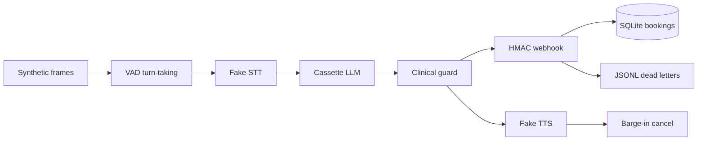

# voice-agent-cascade-lab

Offline lab that tests a simulated STT → LLM → TTS cascade for appointment scheduling: where the latency goes, and whether a tool webhook can retry without booking twice.

> **Honest limits.** The harness computes and gates a latency budget. The p50 and p95 figures below are **SIMULATED** placeholders from a seeded lognormal clock (parameters marked [EST]). They are not a measurement of a speech, language, or synthesis service. The aggressive false-cut rate of 1.0 is **SIMULATED** and holds by construction: the synthetic noise sits above that profile's energy threshold. No microphone, no telephone, and no live provider is called by `eval`, `demo`, or CI.
>
> An optional real-provider run is off by default and is not part of CI. The owner exports `LIVE_MODE=1` and the variables in `.env.example`, then runs `python -m voice_cascade live`. Missing config, or a cost estimate above `MAX_LIVE_SPEND_USD`, exits 2 and sends no request. A run writes `var/live/results.json` (gitignored) and labels every stage `real` or `stub`. Loopback endpoints are stubs unless the owner sets `LIVE_*_SOURCE=real`. The title is `Measured with real providers` only when STT, the language call, and synthesis are all real. Otherwise it is `Partially measured: …`. Stub timings are excluded from end-to-end. With fewer than 20 samples the file reports min, max, and n, and does not report p50 or p95. The table [Measured with real providers](#measured-with-real-providers) stays empty unless the owner pastes a run whose title is exactly that. Do not commit keys.

## Problem and result

A voice cascade hides time in five places: waiting to decide the caller has stopped, waiting for a final transcript, waiting for the first model token, waiting for a tool webhook, and waiting for the first audio byte. Retries on that webhook can also book the same slot twice if the side effect is not idempotent.

On the fictional **Clínica Aurora** (scheduling only, never clinical advice) the harness runs 49 scripted calls. The operating point is the **balanced** VAD profile. The latency cohort is 36 of those calls.

**SIMULATED placeholder, 2026-10-17**, package version **0.1.1**, command `python -m voice_cascade eval` (balanced profile). git revision: `be09444732be7c1d667c0a1d6ffe2120fd3a484c` (runtime tree; the following commit only records this hash).

The harness computes and gates a latency budget. **p95 end-to-end: 1004.5 ms (SIMULATED)** against a budget of 2500 ms. **p50 end-to-end: 896 ms (SIMULATED)**. These two percentiles differ because each stage is a seeded draw, not a constant. They are placeholders until real providers are measured. The same command exits 0 only when the invariant gate passes: task completed or escalated, no double booking, no clinical advice, PII redacted, latency budget held, eligible barge-ins cancelled.

## Demo

```bash
python -m voice_cascade demo
```

`make demo` is the same command. Cost of the demo: **zero**. No API key is read and no network call is made.

## Business case

A scheduling desk that only books, moves, or cancels a slot can contain part of the queue if the cascade stays inside a latency budget and the booking tool cannot double-commit. The ROI sketch is **[EST]** and is not a client forecast. Detail and the formula live in [docs/BUSINESS_CASE.md](docs/BUSINESS_CASE.md).

## Architecture



The fake LLM does not read free text as a model. It folds the transcript, picks an intent, and plays a cassette. The harness fills tool arguments from the script. That limit is deliberate and is called out again below.

## Results

## SIMULATED latency report

All figures below are **SIMULATED** placeholders, from `python -m voice_cascade eval` and `python -m voice_cascade latency-report`. Date: 2026-10-17. Version: 0.1.1. Seed: 42. Percentiles use the inclusive linear method (NumPy type 7) on the 36-call latency cohort. git revision: `be09444732be7c1d667c0a1d6ffe2120fd3a484c`. The harness computes and gates a latency budget. The numbers themselves are placeholders until real providers are measured.

Draws are lognormal. The median is exp(mu). Sigma is the standard deviation of the underlying normal. Box-Muller on `random.Random.random()` keeps Python 3.11 and 3.12 on the same values. Samples are not capped at the budget. The floor is 1 ms. Parameters are **[EST]**.

| Stage | Median ms [EST] | Sigma [EST] |
| --- | ---: | ---: |
| VAD charge | profile end-silence (180 / 400 / 800) | 0.03 |
| STT final | 160 | 0.20 |
| LLM first token | 140 | 0.20 |
| Tool webhook, each successful call | 90 | 0.18 |
| Idempotent replay | 15 | 0.12 |
| TTS first byte | 70 | 0.25 |

Turn-taking decisions stay on the profile thresholds. Only the clock charge is sampled, so the false-cut and barge-in rates do not move when the seed's draws move.

### SIMULATED latency cohort, balanced profile

| Stage | p50 (SIMULATED ms) | p95 (SIMULATED ms) | Budget p95 (ms) |
| --- | ---: | ---: | ---: |
| VAD endpoint | 400.5 | 412.5 | 900 |
| STT final | 155 | 213.75 | 400 |
| LLM TTFT | 137 | 195.5 | 350 |
| Tool webhook | 104 | 206.75 | 800 |
| TTS TTFB | 69.5 | 99.5 | 250 |
| End to end | 896 | 1004.5 | 2500 |

End-to-end is the sum of those stages from end of caller speech to the first TTS byte. Caller audio time is not added on top. Partials are recorded and do not move the end-to-end clock.

### SIMULATED VAD profiles on the same 49 scripts

| Profile | p50 e2e (SIMULATED ms) | p95 e2e (SIMULATED ms) | False-cut rate (SIMULATED) | Missed eligible | Missed barge-in, all attempts | Premature endpoint (SIMULATED) | Gate |
| --- | ---: | ---: | ---: | ---: | ---: | ---: | --- |
| aggressive | 676 | 780 | 1.0 | 0.0 | 0.0 | 1.0 | fail |
| balanced | 896 | 1004.5 | 0.0 | 0.0 | 0.5 | 0.0 | pass |
| patient | 1295 | 1413.75 | 0.0 | 0.0 | 0.5 | 0.0 | pass |

Plain-language labels used in the rest of the docs:

- false-cut rate (aggressive, SIMULATED): 1.0
- false-cut rate (balanced, SIMULATED): 0.0
- false-cut rate (patient, SIMULATED): 0.0
- missed eligible interruptions (balanced, SIMULATED): 0.0
- missed barge-in including sub-threshold (balanced, SIMULATED): 0.5
- premature endpoint (aggressive, SIMULATED): 1.0
- p95 end-to-end (aggressive, SIMULATED): 780 ms
- p95 end-to-end (patient, SIMULATED): 1413.75 ms

False-cut rate is noise bursts during TTS that cancelled playback, divided by noise-burst calls (6). The aggressive rate of 1.0 holds by construction of this script: the synthetic noise has RMS 0.35 and the aggressive threshold is 0.30, so every noise burst is activity. That is a property of the fixture and the threshold, not a field measurement. Missed eligible is speech during TTS that was long enough for that profile and was not cancelled. The 0.5 missed-barge-in figure counts 80 ms bursts that balanced and patient are configured to ignore (4 of 8 barge-in calls). The gate refuses the aggressive profile.

### Robustness cohort

| Script | What is injected | Result in the gate |
| --- | --- | --- |
| R01 | same book delivered twice | one active booking |
| R02 | two callers, one slot | second call escalated, one booking |
| R03 | two HTTP 500s then success | one booking, 3 attempts |
| R04 | timeout before commit | escalated, one dead letter, no booking |
| R05 | slow response after commit | retry returns the same booking |

## Use cases, governance and business strategy

### 1. Use cases

Client-style use cases are fictional. They are patterns, not accounts.

| Use case | Status (Implemented / Design only) | Problem | Who approves | Gated effects | How this repo handles it |
| --- | --- | --- | --- | --- | --- |
| Clínica Aurora appointment scheduling | Implemented | Callers book, ask for slots, or cancel. Latency and double booking are the failure modes. | Clinic operations owns the slot inventory. A human takes clinical questions and failed tools. | `book_appointment`, `cancel_appointment`. `find_slots` is read-only. | Scripted cascade, clinical guard, HMAC webhook, idempotency, DLQ, invariant gate. |
| Pharmacy refill reminder | Design only | Outbound reminder that a refill exists, without discussing dose. | Pharmacist approves the reminder template and the patient list. | Place a call. Must not state a dose or a diagnosis. | Not built. The guard and the escalation copy are the pattern to copy. No dialer. |
| Telecom contact-center triage | Design only | Route a service call to billing, outage, or a person. | Operations approves the intent list and which intents may open a ticket. | Open or update a ticket. | Not built. One intent family is the whole lab. More intents would be new cassettes plus a new gate. |

| Use case | Status (Implemented / Design only) | Problem | Who approves | Gated effects | How this repo handles it |
| --- | --- | --- | --- | --- | --- |
| Personal calendar voice assistant | Design only | Speak a personal hold or a move on your own calendar. | You approve each new event type before it can write. | Create or move a calendar event. | Not built. No calendar API. The booking store is the stand-in for "one write, one idempotency key". |
| Voice notes capture | Design only | Keep a spoken note without acting on it. | You. Nothing is sent. | None. Store text locally. | Not built. No recorder and no consent flow. |

### Design-only vs implemented

| Capability | Status |
| --- | --- |
| Synthetic frames, three VAD profiles, fake STT/LLM/TTS | Implemented |
| Barge-in metrics on 49 scripts | Implemented |
| SIMULATED latency budget, seeded draws, p50/p95 gate | Implemented |
| HMAC webhook, idempotency, bounded retries, DLQ replay | Implemented |
| Invariant eval gate and forced regression | Implemented |
| PII redaction in JSON logs and traces | Implemented |
| Optional live measurement (`python -m voice_cascade live`) | Implemented, off unless `LIVE_MODE=1`, not in CI |
| Refuse-only flags that never send | Implemented, off by default |
| Telephony, WebRTC, neural VAD, speech-to-speech, consent, multi-language | Design only |

### 2. Governance checklist

| Control | Where it lives |
| --- | --- |
| Clinical questions never get advice | `src/voice_cascade/llm.py` guard, cassette `cassettes/clinic.json`, invariant `clinical_advice` |
| Human approval for anything the tool cannot finish | Escalation copy in `llm.py`. The lab does not page a person; it records `escalated`. |
| Traceability | JSON logs `logging_setup.py`, JSONL `trace.py`, SQLite idempotency rows |
| Risks | [docs/RISKS.md](docs/RISKS.md) |
| Costs | [docs/COST.md](docs/COST.md) |
| Incident and rollback | [docs/RUNBOOK.md](docs/RUNBOOK.md) |
| Secrets stay out of the tree | `secretscan.py`, `.env.example`, CI secret-scan job |
| No paid call in CI | `LIVE_MODE` is unset in CI. Tests use a fake HTTP layer. `eval` does not open a socket. |

**Not covered yet**

- Timestamp freshness on webhook retries (retries resend the same body on purpose).
- Caller authentication beyond an opaque `patient_ref`.
- Recording consent, retention, and a real legal hold.
- A human queue UI for escalations.
- Multi-language models and accent measurement on real audio.
- Load, telephony failure, and a second clinic system of record.

### 3. Business strategy

The business problem is narrow: a scheduling queue spends handle time on one intent (book, list, or cancel) and loses trust if a retry creates two appointments. The ROI model is **[EST]** in [docs/BUSINESS_CASE.md](docs/BUSINESS_CASE.md): contained calls times minutes saved times a loaded staffing rate, minus a per-minute voice stack that this repo does not price from a vendor page. Scope and phases are in [docs/SCOPE.md](docs/SCOPE.md). Success metrics are in [docs/METRICS.md](docs/METRICS.md).

**Deployment Strategist conversation.** Start from discovery, not from a model name. Ten questions are in [docs/DISCOVERY.md](docs/DISCOVERY.md): volume, how many calls are actually this one intent, who takes the rest, language, the system of record, consent, and what a failed webhook is allowed to do. Run the cascade in shadow first: it can suggest a slot and a person still commits. Then gate the write behind idempotency, a latency budget, and an explicit approver for the tool. The clinic owns the calendar and the clinical boundary. The platform owner owns the webhook, the dead-letter queue, and the rollback. This lab is the checklist for that conversation. It is not evidence that the conversation already happened with a live desk.

## Decisions

- [0001 Simulated clock and fake providers](docs/adr/0001-simulated-clock.md)
- [0002 Invariant evals, not trajectories](docs/adr/0002-invariant-evals.md)
- [0003 Webhook idempotency and dead letters](docs/adr/0003-webhook-idempotency.md)
- [0004 Clinical guard before TTS](docs/adr/0004-clinical-guard.md)
- [0005 Balanced VAD is the gated profile](docs/adr/0005-balanced-vad.md)

## Security and known limits

Threat notes: [SECURITY.md](SECURITY.md). The demo HMAC constant is not a credential.

### What this does NOT do

- It does not place or receive a phone call.
- It does not, by itself, measure a live speech, language, or synthesis service. The table below stays empty unless every measured stage in the pasted run was real. A partial run stays in `var/live/` and is not copied here.
- It does not give clinical advice, and it must not be used as a medical device.
- It does not prove a production voice deployment. Nothing here was on a live queue.
- It does not understand dates in free text. The cassette names the tool; the script supplies the slot id.
- It does not authenticate a caller, record consent, or speak more than one language.
- It does not load `.env`. Empty placeholders are in `.env.example`.

### Measured with real providers

| Role | Calls | TTFB p50 (ms) | Total p50 (ms) | Price date | Date | Commit | Command |
| --- | ---: | ---: | ---: | --- | --- | --- | --- |

This table stays empty until the owner pastes a run of `python -m voice_cascade live` whose title is exactly `Measured with real providers`. A file titled `Partially measured: LLM real, STT/TTS stub` does not belong here. Stub stage times are not an end-to-end measurement. The command writes `var/live/results.json` and does not edit this file. Live mode has no calendar tool: a reply that states a clock time or "tengo disponible" is an `unsupported_availability_claim` failure.

## How to reproduce

Cost: **zero**. No key, no vendor, no network during tests or evals.

```bash
python3 -m pip install -e ".[dev]"
python3 -m ruff check . && python3 -m ruff format --check .
python3 -m mypy
python3 -m pytest
python3 -m voice_cascade eval
python3 -m voice_cascade secretscan .
```

`make setup`, `make lint`, `make test`, `make eval`, and `make demo` call those commands. `make` may be absent; the `python3 -m` forms are enough.

Forced regression (this process **must exit non-zero**):

```bash
python3 -m voice_cascade eval-regression
```

CI runs that command and fails the job if the exit code is 0. The regression turns the clinical guard off and injects the advice sentence stored under `regression_clinical` in the cassette. A green regression means the gate can no longer see clinical advice.

Latency comparison (SIMULATED):

```bash
python3 -m voice_cascade latency-report
```

Optional real-provider measurement (owner machine only, not CI). Exits 2 with no request when config is missing or the estimate exceeds the cap:

```bash
python -m voice_cascade live
```

## Next steps

1. Run `python -m voice_cascade live` on an owner machine and paste the wall-clock rows into the empty table before any claim about provider latency.
2. Replace script-filled tool arguments with arguments the model actually emitted, and add an invariant that those arguments stay inside the allowed slot set.
3. Add a shadow mode that logs the booking it would have made and does not write.
4. Design the consent and telephony pieces in [docs/SCOPE.md](docs/SCOPE.md) only after a client answers the discovery questions.

## Docs

| Doc | What it is for |
| --- | --- |
| [docs/HOW_IT_WORKS.md](docs/HOW_IT_WORKS.md) | Interview walkthrough, rioplatense Spanish |
| [docs/BUSINESS_CASE.md](docs/BUSINESS_CASE.md) | ROI sketch, all money figures [EST] |
| [docs/DISCOVERY.md](docs/DISCOVERY.md) | Ten questions and what the answer changes |
| [docs/SCOPE.md](docs/SCOPE.md) | Phases, out of scope, exit criteria |
| [docs/RISKS.md](docs/RISKS.md) | Probability, impact, mitigation, owner |
| [docs/METRICS.md](docs/METRICS.md) | What "good" means |
| [docs/COST.md](docs/COST.md) | Simulated row plus [EST] per-minute formula |
| [docs/RUNBOOK.md](docs/RUNBOOK.md) | Stuck webhook, growing DLQ, rollback |
| [docs/architecture.md](docs/architecture.md) | Module map |
| [docs/ADAPT_TO_A_REAL_CLIENT.md](docs/ADAPT_TO_A_REAL_CLIENT.md) | What to throw away first |
| [docs/PROVENANCE.md](docs/PROVENANCE.md) | Eval-kit lineage |
| [docs/adr/](docs/adr/) | Decisions |
