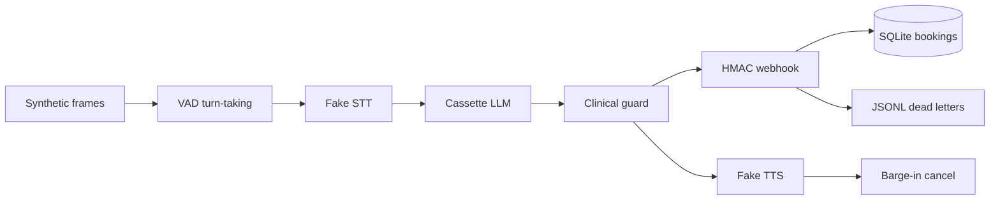

# voice-agent-cascade-lab

[](https://github.com/dlescanogithub/voice-agent-cascade-lab/actions/workflows/ci.yml)

**TL;DR**

- Offline lab that tests a simulated STT → LLM → TTS cascade for appointment scheduling: where the latency goes, and whether a tool webhook can retry without booking twice.
- On 49 scripted calls the balanced VAD profile passes the invariant gate (no double booking, no clinical advice, latency budget held). Latency figures are SIMULATED placeholders, not a live measurement.
- Run `python -m voice_cascade demo`, or start at [docs/HOW_IT_WORKS.md](docs/HOW_IT_WORKS.md).

Offline lab that tests a simulated STT → LLM → TTS cascade for appointment scheduling: where the latency goes, and whether a tool webhook can retry without booking twice.

> **Honest limits.** The harness computes and gates a latency budget. The p50 and p95 figures below are **SIMULATED** placeholders from a seeded lognormal clock (parameters marked [EST]). They are not a measurement of a speech, language, or synthesis service. The aggressive false-cut rate of 1.0 is **SIMULATED** and holds by construction: the synthetic noise sits above that profile's energy threshold. No microphone, no telephone, and no live provider is called by `eval`, `demo`, or CI.
>
> An optional real-provider run is off by default and is not part of CI. Export `LIVE_MODE=1` and the variables in `.env.example`, then run `python -m voice_cascade live`. Missing config, or a cost estimate above `MAX_LIVE_SPEND_USD`, exits 2 and sends no request. One such run is in [Measured with real providers](#measured-with-real-providers): n=20, one provider, one run, not an SLA. Do not commit keys.
>
> `unsupported_availability_claim` is a heuristic. Four handwritten sets, n=20 each, scored 11/20, 15/20, 14/20, and 16/20. The intervals overlap, so those rates are not an improvement. Recall after the latest patterns is not measured yet. Patterns and the labeled samples are in [docs/HEURISTIC_RECALL.md](docs/HEURISTIC_RECALL.md).

## Problem and result

A voice cascade hides time in five places: waiting to decide the caller has stopped, waiting for a final transcript, waiting for the first model token, waiting for a tool webhook, and waiting for the first audio byte. Retries on that webhook can also book the same slot twice if the side effect is not idempotent.

On the fictional **Clínica Aurora** (scheduling only, never clinical advice) the harness runs 49 scripted calls. The operating point is the **balanced** VAD profile. The latency cohort is 36 of those calls.

**SIMULATED placeholder, 2026-10-17**, package version **0.1.9**, command `python -m voice_cascade eval` (balanced profile). git revision: `4fb26ef5a281cc7b325c75c5f6e0f7a96e9a16fa` on main. The same command on that revision prints these percentiles. These 49-call figures were **not re-measured as a published 0.2.0 result**, and the 0.1.9 record does not name a Python version. On this tree the command prints `version=0.2.1` because that is the package version. A local run on `bdd841a` with Python 3.12.3 printed the same percentiles. That run confirms the clock still emits the 0.1.9 figures. It is not a new measurement.

The harness computes and gates a latency budget. **p95 end-to-end: 1004.5 ms (SIMULATED)** against a budget of 2500 ms. **p50 end-to-end: 896 ms (SIMULATED)**. These two percentiles differ because each stage is a seeded draw, not a constant. They are SIMULATED placeholders. The measured table later in this file is a different run and is not a comparison. The same command exits 0 only when the invariant gate passes: task completed or escalated, no double booking, no clinical advice, PII redacted, latency budget held, eligible barge-ins cancelled.

## Demo

Offline, cost **zero**. No API key is read and no network call is made.

```bash
python -m voice_cascade demo
```

`make demo` is the same command.

Short demo in English. It includes a real-provider latency run on a single provider, n=20, not an SLA.

- [video](docs/demo/voice_agent_cascade_lab_demo_en_v2_real.mp4)
- [English captions](docs/demo/voice_agent_cascade_lab_demo_en_v2_real.en.srt)
- [Spanish captions](docs/demo/voice_agent_cascade_lab_demo_en_v2_real.es.srt)

## Business case

A scheduling desk that only books, moves, or cancels a slot can contain part of the queue if the cascade stays inside a latency budget and the booking tool cannot double-commit. The ROI sketch is **[EST]** and is not a client forecast. Detail and the formula live in [docs/BUSINESS_CASE.md](docs/BUSINESS_CASE.md).

## Architecture



The fake LLM does not read free text as a model. It folds the transcript, picks an intent, and plays a cassette. The harness fills tool arguments from the script. That limit is deliberate and is called out again below.

## Results

## SIMULATED latency report

All figures below are **SIMULATED** placeholders, from `python -m voice_cascade eval` and `python -m voice_cascade latency-report`. Date: 2026-10-17. Version: 0.1.9. Seed: 42. Percentiles use the inclusive linear method (NumPy type 7) on the 36-call latency cohort. git revision: `4fb26ef5a281cc7b325c75c5f6e0f7a96e9a16fa` on main. They were not re-measured as a published 0.2.0 result. The 100-call SIMULATED cohort later in this file is a different script. The harness computes and gates a latency budget. The numbers themselves are SIMULATED placeholders. They are not the measured run later in this file.

Draws are lognormal. The median is exp(mu). Sigma is the standard deviation of the underlying normal. Box-Muller on `random.Random.random()` keeps Python 3.11 and 3.12 on the same values. Samples are not capped at the budget. The floor is 1 ms. Parameters are **[EST]**.

| Stage | Median ms [EST] | Sigma [EST] |
| --- | ---: | ---: |
| VAD charge | profile end-silence (180 / 400 / 800) | 0.03 |
| STT final | 160 | 0.20 |
| LLM first token | 140 | 0.20 |
| Tool webhook, each successful call | 90 | 0.18 |
| Idempotent replay | 15 | 0.12 |
| TTS first byte | 70 | 0.25 |

Turn-taking decisions stay on the profile thresholds. Only the clock charge is sampled, so the false-cut and barge-in rates do not move when the seed's draws move.

### SIMULATED latency cohort, balanced profile

| Stage | p50 (SIMULATED ms) | p95 (SIMULATED ms) | Budget p95 (ms) |
| --- | ---: | ---: | ---: |
| VAD endpoint | 400.5 | 412.5 | 900 |
| STT final | 155 | 213.75 | 400 |
| LLM TTFT | 137 | 195.5 | 350 |
| Tool webhook | 104 | 206.75 | 800 |
| TTS TTFB | 69.5 | 99.5 | 250 |
| End to end | 896 | 1004.5 | 2500 |

End-to-end is the sum of those stages from end of caller speech to the first TTS byte. Caller audio time is not added on top. Partials are recorded and do not move the end-to-end clock.

### SIMULATED VAD profiles on the same 49 scripts

| Profile | p50 e2e (SIMULATED ms) | p95 e2e (SIMULATED ms) | False-cut rate (SIMULATED) | Missed eligible | Missed barge-in, all attempts | Premature endpoint (SIMULATED) | Gate |
| --- | ---: | ---: | ---: | ---: | ---: | ---: | --- |
| aggressive | 676 | 780 | 1.0 | 0.0 | 0.0 | 1.0 | fail |
| balanced | 896 | 1004.5 | 0.0 | 0.0 | 0.5 | 0.0 | pass |
| patient | 1295 | 1413.75 | 0.0 | 0.0 | 0.5 | 0.0 | pass |

Plain-language labels used in the rest of the docs:

- false-cut rate (aggressive, SIMULATED): 1.0
- false-cut rate (balanced, SIMULATED): 0.0
- false-cut rate (patient, SIMULATED): 0.0
- missed eligible interruptions (balanced, SIMULATED): 0.0
- missed barge-in including sub-threshold (balanced, SIMULATED): 0.5
- premature endpoint (aggressive, SIMULATED): 1.0
- p95 end-to-end (aggressive, SIMULATED): 780 ms
- p95 end-to-end (patient, SIMULATED): 1413.75 ms

False-cut rate is noise bursts during TTS that cancelled playback, divided by noise-burst calls (6). The aggressive rate of 1.0 holds by construction of this script: the synthetic noise has RMS 0.35 and the aggressive threshold is 0.30, so every noise burst is activity. That is a property of the fixture and the threshold, not a field measurement. Missed eligible is speech during TTS that was long enough for that profile and was not cancelled. The 0.5 missed-barge-in figure counts 80 ms bursts that balanced and patient are configured to ignore (4 of 8 barge-in calls). The gate refuses the aggressive profile.

### Robustness cohort

| Script | What is injected | Result in the gate |
| --- | --- | --- |
| R01 | same book delivered twice | one active booking |
| R02 | two callers, one slot | second call escalated, one booking |
| R03 | two HTTP 500s then success | one booking, 3 attempts |
| R04 | timeout before commit | escalated, one dead letter, no booking |
| R05 | slow response after commit | retry returns the same booking |

## Voice extension (0.2.0, SIMULATED)

Offline only. No provider call. The 49-script table above is the 0.1.9 publication (`4fb26ef`). It was not re-measured on 0.2.0. This extension adds a second path:

- Energy VAD on synthetic 16 kHz PCM, three profiles, a turn state machine, barge-in cancel, and a played-text history check.
- A 100-call cohort. Every latency cell is labelled **SIMULATED**, with a seeded bootstrap interval on p95. It is not compared with the measured table later in this file.
- Webhook cases W01–W12 (signed timestamp, retry classes, tool deadline, full jitter, dead letters). The runbook rows are in [docs/RUNBOOK.md](docs/RUNBOOK.md).

Regenerate the report (cost zero):

```bash
python -m voice_cascade eval-voice
```

The report lives in [docs/voice/SIMULATED_LATENCY.md](docs/voice/SIMULATED_LATENCY.md). That file records the commit and Python version used when the tables were regenerated (`bdd841a`, Python 3.12.3). The regeneration matched the tables already there. A SIMULATED trace for a failed booking is in [docs/voice/TRACE_W01.md](docs/voice/TRACE_W01.md). Open decisions D1–D5, with the offline defaults, are in [docs/voice/OPEN_DECISIONS.md](docs/voice/OPEN_DECISIONS.md). Silero is an optional marker and is off: [docs/voice/SILERO.md](docs/voice/SILERO.md).

`python -m voice_cascade live --dry-run` prints an **[EST]** cost for planning bundle D at size L1 and sends no request. It exits 2 when that estimate is above `MAX_LIVE_SPEND_USD` or the cap is unset.

| Case | What is injected | Result in the gate |
| --- | --- | --- |
| W01 | timeout before commit, 3 times | no booking, one dead letter `timeout` |
| W02 | slow response after commit | same booking id |
| W03 | two 503s then 200 | one booking, 3 attempts |
| W04 | 503 with Retry-After 2s | wait capped at `backoff_cap_ms` |
| W05 | persistent 500 | dead letter `http_5xx` inside the tool bound |
| W06 | truncated JSON | 400, zero retries, `poison_payload` |
| W07 | `slot_id` as a list | 400 `bad_args`, zero retries |
| W08 | missing idempotency key | 400, zero retries |
| W09 | JSON key order changed after signing | 401 `bad_signature`, alert |
| W10 | secret rotated on one side | 401 until `previous` is set, then success |
| W11 | capture 10 minutes old | 401 `stale_timestamp` |
| W12 | duplicate delivery after success | `idempotent_replay` |

## Use cases, governance and business strategy

### 1. Use cases

Client-style use cases are fictional. They are patterns, not accounts.

| Use case | Status (Implemented / Design only) | Problem | Who approves | Gated effects | How this repo handles it |
| --- | --- | --- | --- | --- | --- |
| Clínica Aurora appointment scheduling | Implemented | Callers book, ask for slots, or cancel. Latency and double booking are the failure modes. | Clinic operations owns the slot inventory. A human takes clinical questions and failed tools. | `book_appointment`, `cancel_appointment`. `find_slots` is read-only. | Scripted cascade, clinical guard, HMAC webhook, idempotency, DLQ, invariant gate. |
| Pharmacy refill reminder | Design only | Outbound reminder that a refill exists, without discussing dose. | Pharmacist approves the reminder template and the patient list. | Place a call. Must not state a dose or a diagnosis. | Not built. The guard and the escalation copy are the pattern to copy. No dialer. |
| Telecom contact-center triage | Design only | Route a service call to billing, outage, or a person. | Operations approves the intent list and which intents may open a ticket. | Open or update a ticket. | Not built. One intent family is the whole lab. More intents would be new cassettes plus a new gate. |

| Use case | Status (Implemented / Design only) | Problem | Who approves | Gated effects | How this repo handles it |
| --- | --- | --- | --- | --- | --- |
| Personal calendar voice assistant | Design only | Speak a personal hold or a move on your own calendar. | You approve each new event type before it can write. | Create or move a calendar event. | Not built. No calendar API. The booking store is the stand-in for "one write, one idempotency key". |
| Voice notes capture | Design only | Keep a spoken note without acting on it. | You. Nothing is sent. | None. Store text locally. | Not built. No recorder and no consent flow. |

### Design-only vs implemented

| Capability | Status |
| --- | --- |
| Synthetic frames, three VAD profiles, fake STT/LLM/TTS | Implemented |
| Barge-in metrics on 49 scripts | Implemented |
| SIMULATED latency budget, seeded draws, p50/p95 gate | Implemented |
| HMAC webhook, idempotency, bounded retries, DLQ replay | Implemented |
| Invariant eval gate and forced regression | Implemented |
| PII redaction in JSON logs and traces | Implemented |
| Optional live measurement (`python -m voice_cascade live`) | Implemented, off unless `LIVE_MODE=1`, not in CI |
| Refuse-only flags that never send | Implemented, off by default |
| PCM energy VAD, turn state machine, SIMULATED 100-call report, webhook v2 (W01–W12) | Implemented, offline only. Not a live deployment. |
| Silero neural VAD | Optional marker, off by default, not in CI. Decision D4 open. |
| Telephony, WebRTC, speech-to-speech, consent, multi-language | Design only |

### 2. Governance checklist

| Control | Where it lives |
| --- | --- |
| Clinical questions never get advice | `src/voice_cascade/llm.py` guard, cassette `cassettes/clinic.json`, invariant `clinical_advice` |
| Human approval for anything the tool cannot finish | Escalation copy in `llm.py`. The lab does not page a person; it records `escalated`. |
| Traceability | JSON logs `logging_setup.py`, JSONL `trace.py`, SQLite idempotency rows |
| Risks | [docs/RISKS.md](docs/RISKS.md) |
| Costs | [docs/COST.md](docs/COST.md) |
| Incident and rollback | [docs/RUNBOOK.md](docs/RUNBOOK.md) |
| Secrets stay out of the tree | `secretscan.py`, `.env.example`, CI secret-scan job |
| No paid call in CI | `LIVE_MODE` is unset in CI. Tests use a fake HTTP layer. `eval` does not open a socket. `live --dry-run` prints an [EST] and sends nothing. |
| Interruptions do not keep unplayed text | `history_matches_playback` on the PCM state machine |
| Tool calls are signed with a timestamp | `webhook.py` v2, ADR 0006. v1 still accepted by default (D5 open, deprecated). |
| Non-retryable failures are not retried | W06–W11. A forced regression turns that off and must fail. |
| SIMULATED and MEASURED stay in different tables | `provenance` on the voice report, and a test that rejects a mixed table |
| Log lines for the voice path join to a call and a turn | `call_id`, `turn_id`, `trace --turn` |

**Not covered yet**

- Caller authentication beyond an opaque `patient_ref`.
- Recording consent, retention, and a real legal hold.
- A human queue UI for escalations.
- Multi-language models and accent measurement on real audio.
- Load, telephony failure, and a second clinic system of record.

### 3. Business strategy

The business problem is narrow: a scheduling queue spends handle time on one intent (book, list, or cancel) and loses trust if a retry creates two appointments. The ROI model is **[EST]** in [docs/BUSINESS_CASE.md](docs/BUSINESS_CASE.md): contained calls times minutes saved times a loaded staffing rate, minus a per-minute voice stack that this repo does not price from a vendor page. Scope and phases are in [docs/SCOPE.md](docs/SCOPE.md). Success metrics are in [docs/METRICS.md](docs/METRICS.md).

**Deployment Strategist conversation.** Start from discovery, not from a model name. Ten questions are in [docs/DISCOVERY.md](docs/DISCOVERY.md): volume, how many calls are actually this one intent, who takes the rest, language, the system of record, consent, and what a failed webhook is allowed to do. Run the cascade in shadow first: it can suggest a slot and a person still commits. Then gate the write behind idempotency, a latency budget, and an explicit approver for the tool. The clinic owns the calendar and the clinical boundary. The platform owner owns the webhook, the dead-letter queue, and the rollback. This lab is the checklist for that conversation. It is not evidence that the conversation already happened with a live desk.

### 4. Business value

> **Synthetic example.** The customer below (a fictional diagnostic-imaging network with a Spanish booking line) is invented, and every business figure is a synthetic assumption, tagged **[SYN]**.
>
> - **[REPO]** marks numbers recorded in this repo, with the commit and version the repo gives.
> - **[REPO-EST]** marks this repo's own [EST] figures.
> - **SIMULATED** figures come from the seeded clock, not from a provider.
>
> The plan is *inspired by* the AWS Business Value Realization (BVR) framework. It is not an official AWS template, and I do not hold the AWS BVR Competency, which is awarded to AWS partner companies. Full plan: [docs/BUSINESS_VALUE.md](docs/BUSINESS_VALUE.md).
>
> This plan is not the [EST] sketch in [section 3](#3-business-strategy) or in [docs/BUSINESS_CASE.md](docs/BUSINESS_CASE.md). Those use 8,000 calls a month and a 40% slice, and they do not price a voice-stack tariff.

**What the repo shows [REPO]:**

- On the 49-call script, the balanced VAD profile passes the gate with p50/p95 end-to-end of 896 / 1004.5 ms **SIMULATED** (published on 0.1.9, `4fb26ef`, budget 2500 ms). Those figures were not re-measured as a 0.2.0 result. The current SIMULATED cohort is a different 100-call script: end-to-end p50/p95 807 / 927.150 ms (package 0.2.0, `bdd841a`, Python 3.12.3). The gate fails when the outcome is outside the script, when a phrase check finds clinical advice, when an eligible barge-in is missed, when a cancel takes more than 300 ms, when a dead letter is missing or unexpected, on a false cut, when more than one booking is active for a slot, when scripted PII is in the logs, or when a stage p95 is over budget.
- Webhook cases W01–W12 pass: retries without a second booking, no retries on poison, bad args, a missing idempotency key, a bad signature, or a stale timestamp, and DLQ replay with the same idempotency key.
- One live run (n=20, one provider, `84cfb1a`, not an SLA): STT+LLM+TTS (full audio) p50/p95 2022.5 / 2587.7000000000007 ms. The published run total in [docs/LIVE_RUN.md](docs/LIVE_RUN.md) is US$0.06116773 (LLM ticks plus a list-price STT+TTS estimate; that total is not a field in `results.json`). It failed one heuristic invariant (`unsupported_availability_claim:S15`), and the live command returns exit 1 when `invariants.passed` is false. The stored live end-to-end p95 is above the lab's 2500 ms budget. The live TTS first-byte p95 is 380.05 ms, above the 250 ms TTS TTFB budget. Live mode does not apply those budgets. Live end-to-end is full audio; the lab end-to-end budget stops at the first TTS byte.

**How a team would track value:**

| KPI | Category | Baseline | Target |
| --- | --- | --- | --- |
| p95 end-to-end, measured on the real line | Agility / CX | 1004.5 ms SIMULATED (0.1.9, not re-measured on 0.2.0); 0.2.0 100-call p95 927.150 ms SIMULATED; live full-audio p95 2587.7000000000007 ms (different definition) [REPO] | ≤2500 ms MEASURED, n≥100 [SYN] |
| Stage p95: STT / LLM TTFT / tool / TTS TTFB | Agility | 213.75 / 195.5 / 206.75 / 99.5 ms SIMULATED, 49-call cohort, 0.1.9 [REPO]. 0.2.0 100-call p95: 218.150 / 191.050 / 116.100 / 102.050 ms [REPO] | ≤400 / 350 / 800 / 250 ms [REPO budget] on real audio [SYN] |
| False-cut rate | CX | 0.0 SIMULATED (balanced) [REPO] | 0 on consented real audio [SYN] |
| Containment of the booking slice | Productivity | 0% [SYN] | 50% [SYN; the repo uses 50% of a different slice as REPO-EST] |
| Double bookings | Resilience / cost | ~30 per month [SYN] | 0 [REPO invariant] |
| Dead letters / retries of non-retryable errors | Resilience | not measured [SYN] | ≤1% / 0 [SYN / REPO W06–W11] |
| Voice-stack cost per minute | Cost | live US$0.06116773 for 20 turns, published sum [REPO] | ≤USD 0.06/min incl. telephony [SYN] |

**Year-1 ROI [SYN]:** ROI = (benefit − cost) / cost.

- **Base** (50% containment): ≈ **49.8%**, payback ≈ **6.3 months**.
- **Conservative** (30% containment): ≈ −5.5%, payback ≈ 13.3 months.
- **Minimum** (10% containment): ≈ −60.8%, never pays back.

In voice, containment drives the ROI. The voice stack is paid on every handled call.

## Decisions

- [0001 Simulated clock and fake providers](docs/adr/0001-simulated-clock.md)
- [0002 Invariant evals, not trajectories](docs/adr/0002-invariant-evals.md)
- [0003 Webhook idempotency and dead letters](docs/adr/0003-webhook-idempotency.md)
- [0004 Clinical guard before TTS](docs/adr/0004-clinical-guard.md)
- [0005 Balanced VAD is the gated profile](docs/adr/0005-balanced-vad.md)
- [0006 Signed webhook timestamp](docs/adr/0006-signed-webhook-timestamp.md)

## Security and known limits

Threat notes: [SECURITY.md](SECURITY.md). The demo HMAC constant is not a credential.

### What this does NOT do

- It does not place or receive a phone call.
- It does not, by itself, measure a live speech, language, or synthesis service. The table below is one pasted run in which every measured stage was real. A partial run stays in `var/live/` and is not copied here.
- It does not give clinical advice, and it must not be used as a medical device.
- It does not prove a production voice deployment. Nothing here was on a live queue.
- It does not understand dates in free text. The cassette names the tool; the script supplies the slot id.
- It does not authenticate a caller, record consent, or speak more than one language.
- It does not load `.env`. Empty placeholders are in `.env.example`.

### Measured with real providers

| Role | Calls | p50 (ms) | p95 (ms) | Price date | Date | Commit | Command |
| --- | ---: | ---: | ---: | --- | --- | --- | --- |
| STT, xAI, real | 20 | 245 | 281.5 | 2026-10-17 | 2026-10-17/18 | `84cfb1a` | `python -m voice_cascade live` |
| LLM, xAI, grok-4.20-0309-non-reasoning | 20 | 798.5 | 1145.3 | 2026-10-17 | 2026-10-17/18 | `84cfb1a` | `python -m voice_cascade live` |
| TTS, xAI, full audio (first byte p50 302 ms) | 20 | 993.5 | 1253.6 | 2026-10-17 | 2026-10-17/18 | `84cfb1a` | `python -m voice_cascade live` |
| End-to-end, STT+LLM+TTS, real only | 20 | 2022.5 | 2587.7 | 2026-10-17 | 2026-10-17/18 | `84cfb1a` | `python -m voice_cascade live` |

p50 and p95 in this table are rounded to 0.1 ms from [docs/live/2026-10-17-results.json](docs/live/2026-10-17-results.json). The stored `p95_ms` values are STT 281.45000000000005, LLM 1145.3000000000002, TTS full audio 1253.6000000000004, and end-to-end 2587.7000000000007. The stored p50 values are 245.0, 798.5, 993.5, and 2022.5. The STT p50 is shown as 245.

Sixty HTTP calls, all status 200 (20 STT, 20 LLM, 20 TTS). The file title is `Measured with real providers`. A file titled `Partially measured: LLM real, STT/TTS stub` does not belong here. Stub stage times are not in the end-to-end row. The command writes `var/live/results.json` and does not edit this file. The copy used for these cells is [docs/live/2026-10-17-results.json](docs/live/2026-10-17-results.json).

n=20, one provider, one run, not an SLA. VAD is simulated and the calendar tool does not run in live mode. Caller audio was synthesized with TTS, in Spanish, not a human voice. One response tripped `unsupported_availability_claim:S15`. `invariants.passed` is false, so the command exits 1. That failure is shown, not dropped. The results file does not store the process exit code. `cmd_live` returns 1 when `invariants.passed` is not true, and [docs/LIVE_RUN.md](docs/LIVE_RUN.md) states that exit. The run used a temporary adapter outside this repo. A rehearsal with the same code, [docs/live/2026-10-17-rehearsal.json](docs/live/2026-10-17-rehearsal.json), had end-to-end p50/p95 2050 / 3386.3 ms, so run-to-run variation is real. These rows are not compared with the SIMULATED table above.

The stored live end-to-end p95 (2587.7000000000007 ms, `84cfb1a`, n=20) is above the lab's 2500 ms budget (`StageBudget.e2e_ms`). The live TTS first-byte p95 is 380.05 ms (p50 302 ms), above the 250 ms TTS TTFB budget (`StageBudget.tts_ttfb_ms`). First-byte p50/p95 are not keys in the `latency` object. They come from rounding each `turns[].tts.ttfb_ms` to an integer millisecond and taking the same percentile. Live mode does not apply `StageBudget`, and this exit 1 is the heuristic failure, not a budget failure. Definitions differ: live end-to-end sums full STT, LLM, and TTS audio, while the lab end-to-end budget stops at the first TTS byte. The 380.05 ms figure is first-byte time. The TTS row in the table is full audio.

Cost for this run: LLM US$0.0036684 from `usage.cost_in_usd_ticks` (36,684,000 ticks, 1 tick = 1e-10 USD), which is about US$0.003668. STT+TTS about US$0.0575 estimated from list prices (49.296 audio seconds at US$0.10 per hour, plus 3742 characters at US$15 per 1M characters). The speech API does not report that dollar amount. Run total about US$0.0612. The results file does not store the model id; `grok-4.20-0309-non-reasoning` is the model named for this run in [docs/LIVE_RUN.md](docs/LIVE_RUN.md). List prices were read on 2026-10-18.

`unsupported_availability_claim` is a heuristic. Four handwritten sets (n=20 each; intervals overlap; not an improvement) scored 11/20, 15/20, 14/20, and 16/20. Recall after the latest patterns is not measured yet. The pattern list and the labeled samples are in [docs/HEURISTIC_RECALL.md](docs/HEURISTIC_RECALL.md).

In `results.json`, `cost.estimated_usd` is tokens times the env price, with `cost_basis` `tokens_x_price, cached tokens priced separately`. Cached tokens use the cached price only when the response reports them and that price is set. That product is never stored as `provider_reported_usd`. `provider_reported_usd` is present only when the response includes integer `usage.cost_in_usd_ticks` (1 tick = 1e-10 USD), and the report also keeps the raw tick count and `provider_cost_source`. `usage.cost`, a fractional dollar amount, and a pre-filled `provider_reported_usd` are ignored. `cost.precall_estimate_usd` is the cap check before any request.

## How to reproduce

Cost: **zero**. No key, no vendor, no network during tests or evals.

```bash
python3 -m pip install -e ".[dev]"
python3 -m ruff check . && python3 -m ruff format --check .
python3 -m mypy
python3 -m pytest
python3 -m voice_cascade eval
python3 -m voice_cascade secretscan .
```

`make setup`, `make lint`, `make test`, `make eval`, and `make demo` call those commands. `make` may be absent; the `python3 -m` forms are enough.

Forced regression (this process **must exit non-zero**):

```bash
python3 -m voice_cascade eval-regression
```

CI runs that command and fails the job if the exit code is 0. The regression turns the clinical guard off and injects the advice sentence stored under `regression_clinical` in the cassette. A green regression means the gate can no longer see clinical advice.

Local `python3 -m pytest` on Python 3.12.3, package 0.2.1, with the addopts in `pyproject.toml` (`--cov=voice_cascade`, fail-under 80): **105 passed**, total coverage **92.97%**. The suite is unchanged from `bdd841a`. It is not a CI badge.

Latency comparison (SIMULATED):

```bash
python3 -m voice_cascade latency-report
```

Optional real-provider measurement (not CI). Exits 2 with no request when config is missing or the estimate exceeds the cap:

```bash
python -m voice_cascade live
```

## Next steps

1. The measured table above already holds one real-provider run (2026-10-17/18, `84cfb1a`, n=20). It is not an SLA, and it was not repeated on 0.2.0. A later run is a new row with its own commit. Do not treat that one run as a service level.
2. Replace script-filled tool arguments with arguments the model actually emitted, and add an invariant that those arguments stay inside the allowed slot set.
3. Add a shadow mode that logs the booking it would have made and does not write.
4. Design the consent and telephony pieces in [docs/SCOPE.md](docs/SCOPE.md) only after a client answers the discovery questions.

## Docs

| Doc | What it is for |
| --- | --- |
| [docs/HOW_IT_WORKS.md](docs/HOW_IT_WORKS.md) | Interview walkthrough, rioplatense Spanish |
| [docs/BUSINESS_CASE.md](docs/BUSINESS_CASE.md) | ROI sketch, all money figures [EST] |
| [docs/BUSINESS_VALUE.md](docs/BUSINESS_VALUE.md) | Value-realization plan. Business figures [SYN] unless marked [REPO] or [REPO-EST] |
| [docs/DISCOVERY.md](docs/DISCOVERY.md) | Ten questions and what the answer changes |
| [docs/SCOPE.md](docs/SCOPE.md) | Phases, out of scope, exit criteria |
| [docs/RISKS.md](docs/RISKS.md) | Probability, impact, mitigation, owner |
| [docs/METRICS.md](docs/METRICS.md) | What "good" means |
| [docs/HEURISTIC_RECALL.md](docs/HEURISTIC_RECALL.md) | Availability patterns and the four handwritten recall sets |
| [docs/COST.md](docs/COST.md) | Simulated row plus [EST] per-minute formula |
| [docs/LIVE_RUN.md](docs/LIVE_RUN.md) | One measured xAI run, evidence files, no keys |
| [docs/RUNBOOK.md](docs/RUNBOOK.md) | Stuck webhook, growing DLQ, rollback |
| [docs/design/VOICE_EXTENSION_DESIGN.md](docs/design/VOICE_EXTENSION_DESIGN.md) | Design for the voice extension. Offline parts are in 0.2.0. The paid live run is not. |
| [docs/voice/SIMULATED_LATENCY.md](docs/voice/SIMULATED_LATENCY.md) | 100-call SIMULATED latency and turn-taking report |
| [docs/voice/OPEN_DECISIONS.md](docs/voice/OPEN_DECISIONS.md) | D1–D5 defaults. None of them is closed. |
| [docs/architecture.md](docs/architecture.md) | Module map |
| [docs/ADAPT_TO_A_REAL_CLIENT.md](docs/ADAPT_TO_A_REAL_CLIENT.md) | What to throw away first |
| [docs/PROVENANCE.md](docs/PROVENANCE.md) | Eval-kit lineage |
| [docs/adr/](docs/adr/) | Decisions |

## Authorship and how this was built

This repository was built with AI-assisted development.

**What I did (Diego Lescano):**
- Chose the problem and the scope: which failure to show, what is out of scope, and what the repo must not claim.
- Set the governance and business-strategy requirements for every case: approval controls, traceability, risks and costs, estimated ROI, rollout and metrics.
- Set the engineering standards: Python, tests, CI, synthetic data only, no real client or employer data.
- Reviewed and approved each change before merge, and decided what became public and when.
- Ran or approved the live measurements, and decided to publish the failures and the limits of the results as they came out.

**What AI coding agents did:**
- Wrote most of the code, tests and documentation, working from my briefs and under my review.
- Produced the demo videos and subtitles from real runs of this code; narration voice is synthetic (xAI TTS).

**What this repo does not claim:**
- It is not a production system, and every data set is synthetic.
- Live numbers come from a small sample, one model and one prompt; they are indicative, not conclusive.
