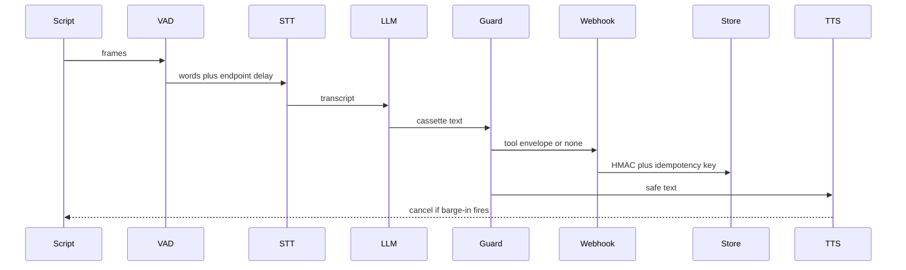

# Architecture

The README has the short flowchart. This page is the module map.

| Module | Role |
| --- | --- |
| `audio.py` | Frames and an optional WAV reader. |
| `vad.py` | aggressive / balanced / patient. |
| `stt.py` | Partials, final, seeded word errors. |
| `llm.py` | Intent fold, cassette, clinical guard. |
| `tts.py` | Chunks, TTFB, cancel. |
| `booking.py` | SQLite slots, one active booking per slot, idempotency table. |
| `webhook.py` | HMAC, client retries, faults, JSONL DLQ, optional HTTP server. |
| `pipeline.py` | One call on `SimulatedClock`. |
| `evalkit.py` | Invariants. |
| `scenarios.py` | 49 synthetic calls. |
| `providers.py` | Real adapters that raise and do not send. |
| `pii.py`, `logging_setup.py`, `trace.py` | Redaction, JSON logs, JSONL traces. |
| `secretscan.py` | CI scan. |

## Clock

`SimulatedClock` starts at 0 for each call. The pipeline advances it by the VAD endpoint, the STT final, the LLM TTFT, whatever the webhook client consumed, and the TTS time to first byte. Barge-in latency is recorded beside that sum. It is the time to reach `min_speech_ms`, and it does not change the end-to-end number.

## Why the tool arguments are not "from the model"

`plan_for` returns tool names. `pipeline._envelope` fills `slot_id`, `patient_ref`, and `booking_id` from the scenario. A cassette-driven lab can prove idempotency and escalation. It cannot prove that a model chose the right slot from a sentence. [ADAPT_TO_A_REAL_CLIENT.md](ADAPT_TO_A_REAL_CLIENT.md) says to replace that binding first.

## Failure simulator

| Mode | Where it acts | What the tests show |
| --- | --- | --- |
| `http_500` | Client, before the handler | Two failures then one booking |
| `timeout_before_commit` | Client, handler not called | DLQ, no row |
| `slow_after_commit` | Handler runs, client times out, retry | Same booking id |
| duplicate delivery | Second invoke, same key | `idempotent_replay` |
| out of order | `ResponseBuffer.release_lifo` | Two slots, one row each, replay still one |

## Process boundaries

Default path is in-process so tests open no vendor connection and do not need a port. `webhook-serve` binds localhost for a manual poke. CI does not start it.
