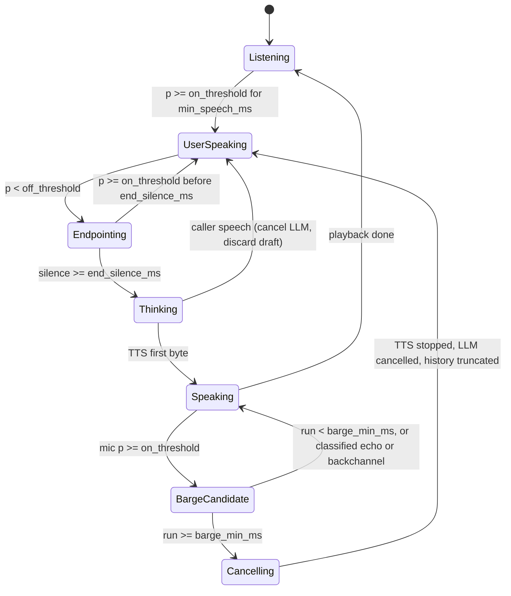

# Design: turn-taking, per-stage latency, and webhook failure debugging (v0.2 extension)

**Status:** Draft v1, design only. Not merged. No code, no paid run.
**Date:** 2026-10-19
**Target package version:** 0.2.0
**Baseline:** `main` at `38ae14e` (package 0.1.9)

> **Labels used in this document.** **SIMULATED**: produced by the seeded clock or by synthetic audio inside this repo. **MEASURED**: wall-clock or provider-reported numbers from a recorded run, with a date, a commit and an evidence file. **[EST]**: an assumption or a planning number. This document contains no new MEASURED number. Every threshold below is a starting point **[EST]**, to be tuned on the synthetic corpus and then re-checked on a live run.

## 1. Context

The lab already has:

- An energy VAD with three profiles (aggressive, balanced, patient) that works on *timed tokens*, not on PCM samples (`audio.py`, `vad.py`). Barge-in is a run-length check on those tokens.
- A seeded lognormal clock that produces **SIMULATED** p50/p95 per stage on a 36-call cohort out of 49 scripts.
- A local HMAC webhook with idempotency keys, bounded retries, seeded jitter, a JSONL dead-letter queue and replay (`webhook.py`, ADR 0003). It already returns 401 on a bad signature and 400 on bad JSON.
- One live run (n=20, one provider, MEASURED, 2026-10-17/18) in which VAD and the calendar tool were stubs.

What this extension adds, and why:

| Gap today | Why it matters in a voice cascade | This design |
| --- | --- | --- |
| VAD reads labelled tokens, not audio. No neural VAD. | Turn-taking errors come from real acoustics: noise, echo of the agent's own voice, backchannels, mid-sentence pauses. | A `VadBackend` interface over 16 kHz PCM, the existing energy VAD ported to it, and an optional Silero VAD backend (offline, CPU). |
| Barge-in is a single threshold, with no explicit state machine and no cancellation semantics. | A cut that does not stop the LLM and the TTS, or that leaves unplayed text in the history, produces a confused next turn. | An explicit turn-taking state machine with cancellation rules and a "played text only" history invariant. |
| Latency cohort is 36 calls, SIMULATED only. Live mode skips VAD and the tool. | p95 on small n is mostly noise. A live run that skips stages cannot be compared stage by stage. | A 100-call synthetic cohort with a fixed report schema, the same schema for a future MEASURED run, and a strict provenance label per row. |
| Webhook failures are covered for 500 and timeouts. No timestamp freshness, no 4xx retry classification, no correlation id per turn and attempt in logs. | Most webhook incidents are diagnosed from logs. Without a per-turn id you cannot join the voice trace to the tool trace. | Signed timestamps, retry classification, an overall tool deadline, a correlation id on every log line, and a symptom → check → fix runbook. |

## 2. Goals and non-goals

**Goals**

1. Turn-taking on synthetic PCM with ground-truth labels, measured as false barge-in rate, missed barge-in rate, barge-in reaction time, endpointing delay, and premature endpoint rate.
2. Per-stage latency (VAD endpoint, STT final, LLM first token, tool, TTS first byte, end to end) on about 100 synthetic calls, SIMULATED now and MEASURED later, never mixed in one table.
3. A failing-webhook cohort (timeout, 5xx, malformed payload, invalid signature, stale timestamp) with traceable structured logs and a debugging runbook.
4. The governance and business-strategy section in the same structure as the other portfolio repos.

**Non-goals**

- Telephony, SIP, WebRTC, or a phone number that rings.
- Real human recordings or any personal voice data.
- Acoustic echo cancellation. The design simulates echo leakage and measures its effect. It does not implement AEC.
- A speech-to-speech bake-off.
- Any claim that the system is fit for a live deployment. This stays a lab.

## 3. Turn-taking: VAD and barge-in

### 3.1 Audio contract

- Mono, 16 kHz, 16-bit PCM, processed in 32 ms windows (512 samples). Silero VAD expects 512-sample windows at 16 kHz.
- Two logical channels per call, kept separate:
  - `mic`: what the caller side "hears": caller speech + noise + agent echo leakage.
  - `agent_out`: what the agent is playing (TTS audio or a synthetic stand-in).
- Every synthetic clip has a JSON sidecar with ground truth in samples: speech onsets and offsets, internal pauses, noise events, echo segments, backchannels and the intended label for each (`turn_end`, `pause`, `barge_in`, `backchannel`, `noise`, `echo`).

### 3.2 VAD backends

```python
class VadBackend(Protocol):
    name: str

    def reset(self) -> None: ...
    def speech_prob(self, window: Sequence[int]) -> float:
        """Probability in [0, 1] for one 512-sample window."""
```

| Backend | Dependency | Where it runs | Notes |
| --- | --- | --- | --- |
| `energy` | none (stdlib) | CI, always | Port of today's RMS rule. Output is 0/1 against the profile threshold. Keeps the base package at zero runtime dependencies. |
| `silero` | optional extra `voice-agent-cascade-lab[vad]` (`silero-vad`, MIT, which pulls `torch`; or the ONNX model via `onnxruntime`) | Local and an optional CI lane | Offline, CPU. Model weights are downloaded by the package, never committed. Version pinned in the extra. |

The decision layer (state machine and hysteresis) is shared, so a backend swap changes only `speech_prob`.

### 3.3 State machine



Parameters per profile, all **[EST]** starting points:

| Parameter | aggressive | balanced | patient |
| --- | ---: | ---: | ---: |
| `on_threshold` (speech prob) | 0.40 | 0.50 | 0.60 |
| `off_threshold` (hysteresis) | 0.25 | 0.35 | 0.45 |
| `min_speech_ms` | 64 | 128 | 224 |
| `end_silence_ms` | 192 | 416 | 800 |
| `barge_min_ms` | 96 | 192 | 288 |
| `cancel_bound_ms` (speech onset → TTS stopped) | 300 | 300 | 300 |

Durations are multiples of 32 ms where possible so that window rounding does not hide in the results.

Rules:

1. **Echo guard.** While `Speaking`, a mic window whose energy envelope correlates with `agent_out` above `echo_corr` (**[EST]** 0.6, lag search 0–120 ms) is labelled echo and does not count toward `barge_min_ms`. This is a lab heuristic, not AEC, and the doc says so wherever it is reported.
2. **Backchannel.** A mic speech run shorter than `barge_min_ms` that ends before the threshold ("sí", "ajá" in the synthetic script) does not cancel. It is logged as `backchannel_ignored`.
3. **Cancellation is total.** `Cancelling` stops TTS, cancels the in-flight LLM stream, and cancels any not-yet-sent tool call. A tool call already sent is never cancelled from the voice side. The idempotency key covers its retry.
4. **Played text only.** The assistant turn kept in history is truncated to the characters whose audio was played before the stop. Invariant `history_matches_playback`.
5. **Thinking interruption.** Caller speech during `Thinking` discards the draft. No TTS for a discarded draft.

### 3.4 Metrics

All computed against the ground-truth sidecar. Opportunities and denominators are reported with every rate.

| Metric | Definition | Gate on balanced **[EST]** |
| --- | --- | --- |
| False barge-in rate | Cancellations whose cause is noise, echo or backchannel, divided by agent-speaking segments that contain such an event | ≤ 0.05 |
| Missed barge-in rate | True barge-ins (speech ≥ `barge_min_ms`) that did not cancel, divided by true barge-ins | ≤ 0.05 |
| Barge-in reaction time p50/p95 | True speech onset → TTS stopped | p95 ≤ `cancel_bound_ms` |
| Endpointing delay p50/p95 | True end of caller speech → endpoint decision | p95 ≤ 900 ms |
| Premature endpoint rate | Endpoint fired inside an internal pause, divided by utterances with an internal pause | ≤ 0.05 |
| History integrity | Calls where history ≠ played text | 0 (hard invariant) |

Thresholds are a starting gate for the synthetic corpus. They are not a claim about real callers.

### 3.5 Testing with synthetic audio

A seeded generator (`python -m voice_cascade synth-audio --seed 42`) writes clips plus sidecars into the data directory. Nothing large is committed. A handful of small fixtures (under 200 KB total) are committed for unit tests.

Two fixture tiers, because a neural VAD is trained on real speech and will not fire on tones:

| Tier | Content | Used for | Backend |
| --- | --- | --- | --- |
| DSP | Speech-like signal: harmonic stack (F0 100–220 Hz) with syllable-rate amplitude modulation (4–6 Hz) and formant-shaped noise. Noise beds: white, pink, babble (summed DSP voices). Impulses (clicks, a cough envelope). Echo = `agent_out` delayed 40–120 ms at −20 to −10 dB. | State machine, hysteresis, echo guard, metric math | `energy` (deterministic, CI) |
| Voice | Short synthetic Spanish phrases from a TTS voice, generated once and cached. Mixed with the same noise beds at SNR 20 / 10 / 5 dB. | Silero behaviour, false barge-in under noise | `silero` (optional lane) |

Corpus size **[EST]**: 100 calls × 4 turns. Each call draws one condition (SNR, noise type, internal pause 200–900 ms, echo level, backchannel yes/no, barge-in timing). The draw table is in the report so any rate can be traced back to its condition.

The voice tier needs synthetic speech. Options are listed in Open decisions: an offline TTS engine (zero cost, robotic voice) or a one-time paid TTS batch that is cached and never re-billed.

## 4. Per-stage latency over ~100 synthetic calls

### 4.1 Timestamps per turn

| Mark | Meaning |
| --- | --- |
| `t_speech_end` | Ground truth end of caller speech (from the sidecar) |
| `t_endpoint` | State machine leaves `Endpointing` |
| `t_stt_final` | Final transcript available |
| `t_llm_first_token` | First LLM token received |
| `t_tool_done` | Tool response accepted (only on tool turns) |
| `t_tts_first_byte` | First TTS audio byte received |

Stage durations: `vad_endpoint = t_endpoint − t_speech_end`, `stt_final = t_stt_final − t_endpoint`, `llm_ttft = t_llm_first_token − t_stt_final`, `tool = t_tool_done − (tool call emitted)`, `tts_ttfb = t_tts_first_byte − (first text chunk sent to TTS)`, `e2e = t_tts_first_byte − t_speech_end`.

Streaming STT can finalize before the endpoint. When that happens `stt_final` is recorded as 0 and the overlap is reported, not hidden.

### 4.2 SIMULATED vs MEASURED

| | SIMULATED (this extension, offline) | MEASURED (future live run) |
| --- | --- | --- |
| Clock | Seeded lognormal, parameters **[EST]**, same Box-Muller code as today | `time.perf_counter_ns()` on the client |
| VAD | Real computation on synthetic PCM; endpointing delay is the policy hang time plus window rounding | Same local VAD on the same synthetic audio; local CPU time recorded separately |
| STT / LLM / TTS | Fake providers | Real provider HTTP or streaming calls |
| Tool | In-process webhook with fault plan | Same local webhook over loopback HTTP, so it is MEASURED local time, labelled as such |
| Output file | `reports/latency_simulated.json` | `var/live/latency_measured.json`, copied into `docs/live/` only after review |
| README | Table titled `SIMULATED latency report` | Table titled `Measured with real providers`, with date, commit, provider, model, n |

Report rules:

- Every row carries `provenance` (`SIMULATED` or `MEASURED`), `n`, `seed` or run date, commit, and the percentile method (inclusive linear, NumPy type 7, as today).
- A SIMULATED and a MEASURED number never share a table and are never subtracted or compared as an improvement.
- p95 on n≈100 rests on about 5 tail samples. Each p95 is shown with a bootstrap 95% interval (2,000 resamples, seeded) so the width is visible.
- Cold-start turns (first turn per call) are reported both included and separately. The rule is fixed before the run, not after.
- A partial live run (any stage stubbed) is written with title `Partially measured` and is not copied into the README, as today.

## 5. Failing webhook scenario

### 5.1 What exists and what changes

Kept: HMAC-SHA256, idempotency keys, SQLite partial unique index, bounded exponential backoff with seeded jitter, JSONL dead letters, replay.

Added:

1. **Signed timestamp (v2 signature).** `X-Voice-Signature: t=<unix_s>,v1=<hex>` over `"{t}.{raw_body}"`. Tolerance 300 s **[EST]**. Retries resend the original `t`, so a retry inside the window passes and a replay of an old capture fails with `stale_timestamp`. Two active secrets allowed during rotation (`current`, `previous`). The v1 header stays accepted behind `VOICE_CASCADE_ACCEPT_V1_SIGNATURE` (default on in 0.2.0, documented as deprecated). New ADR 0006.
2. **Retry classification.**

   | Response | Retry? | Outcome when attempts run out |
   | --- | --- | --- |
   | timeout, connection reset | yes | dead letter `timeout` |
   | 500, 502, 503, 504 | yes | dead letter `http_5xx` |
   | 429 or 503 with `Retry-After` | yes, wait `min(Retry-After, backoff_cap_ms)` | dead letter `throttled` |
   | 400 `bad_json`, `bad_args`, `missing_idempotency_key` | no | dead letter `poison_payload` immediately, no retry |
   | 401 `bad_signature`, `stale_timestamp` | no | dead letter `auth_failed`, alert event |
   | 409 `slot_unavailable` (stored result) | no | normal tool result, the agent offers another slot |

3. **Overall tool deadline.** Per-turn budget for the tool across all attempts (**[EST]** 1,500 ms simulated). When it is exhausted the agent says it could not confirm and escalates. Attempts already in flight are not cancelled. Their outcome is logged and the idempotency key keeps a late commit safe.
4. **Full jitter.** `delay = rand(0, min(cap, base·2^n))`, seeded per key and attempt, replacing today's additive jitter. Same bound, less synchronised retries. Covered by a property test.
5. **Payload validation before side effects.** Schema check (types, required fields, `idempotency_key` length and charset, `slot_id` in the inventory) returns 400 before any store access.

### 5.2 Fault cohort

| Id | Injected fault | Expected result (invariant) |
| --- | --- | --- |
| W01 | Timeout before commit, 3 times | No booking, one dead letter `timeout`, escalated |
| W02 | Slow response after commit | Retry returns the same booking id, one active booking |
| W03 | Two 503s, then 200 | One booking, 3 attempts, delays within bound |
| W04 | 503 with `Retry-After: 2` | Wait capped at `backoff_cap_ms`, attempts ≤ max |
| W05 | Persistent 500 | Dead letter after max attempts, total time ≤ tool deadline + one timeout |
| W06 | Truncated JSON body | 400, zero retries, dead letter `poison_payload`, no store access |
| W07 | Wrong types (`slot_id` as a list) | 400 `bad_args`, zero retries |
| W08 | Missing `idempotency_key` | 400 `missing_idempotency_key`, zero retries |
| W09 | Body re-serialized by a proxy (key order changed) | 401 `bad_signature`, zero retries, alert event |
| W10 | Wrong secret, rotation done on one side only | 401, alert; succeeds when `previous` secret is configured |
| W11 | Capture replayed after 10 minutes | 401 `stale_timestamp` |
| W12 | Duplicate delivery after success | Same stored result, `idempotent_replay` true |

R01–R05 stay as they are. W01–W12 run in `eval` and gate CI.

### 5.3 Structured logs with correlation ids

One JSON object per line, PII redacted first (existing `logging_setup.py`). Required fields on every voice and tool event:

```json
{
  "ts": "2026-10-19T12:00:00.000Z",
  "level": "WARNING",
  "event": "tool.attempt.failed",
  "provenance": "SIMULATED",
  "call_id": "c-0042",
  "turn_id": "c-0042:t03",
  "span_id": "c-0042:t03:tool:a2",
  "tool": "book_appointment",
  "attempt": 2,
  "max_attempts": 3,
  "idempotency_key_hash": "sha256:9f1c…(12 hex)",
  "http_status": 503,
  "error_class": "http_5xx",
  "retryable": true,
  "retry_in_ms": 212,
  "elapsed_ms": 300,
  "deadline_left_ms": 688
}
```

- `X-Correlation-Id: <turn_id>` and `X-Request-Id: <span_id>` are sent on every webhook attempt. The server logs both.
- The raw idempotency key is not logged. A truncated hash is enough to join rows.
- Dead letters carry `call_id`, `turn_id`, `span_id`, `error_class`, `attempts`, and the first and last status.
- New CLI: `python -m voice_cascade trace --turn c-0042:t03` prints the joined timeline of VAD, STT, LLM, tool attempts and TTS for one turn from `trace.jsonl` and the log file.

### 5.4 Debugging runbook (added to `docs/RUNBOOK.md`)

| Symptom | Check | Fix |
| --- | --- | --- |
| Caller hears "could not confirm", no booking | `trace --turn <id>`: `error_class` of each attempt. `timeout` on every attempt with no commit row means the dependency is down or slow. | Fix the dependency, then `dlq-replay`. Do not mint a new idempotency key. |
| Caller hears "could not confirm", but a booking exists | Attempts show `timeout` after the store committed (`slow_after_commit`). | Replay with the same key returns the booking. Raise the timeout only if p95 tool latency, MEASURED, is above it. |
| Every call fails with 401 `bad_signature` since a deploy | Compare the signer and verifier secret ids in the logs (ids, never values). Check whether a proxy re-serializes JSON (W09). | Roll the secret on both sides with the `previous` slot, or sign the raw bytes the proxy forwards. Do not disable verification. |
| Sporadic 401 `stale_timestamp` | Clock skew between signer and verifier, or a queued retry older than the tolerance. | Sync clocks (NTP). Lower queue depth. Do not widen the tolerance silently; that is an ADR change. |
| DLQ grows with `poison_payload` | Group DLQ by `error_class` and the first validation error. A model-filled argument out of schema is the usual cause. | Fix the prompt, schema or mapping. Poison letters are not replayed as is. Repair or drop them with a recorded reason. |
| Retry storm, 503 rising | `attempt` distribution and `retry_in_ms`. Missing jitter or `Retry-After` ignored. | Confirm full jitter is on and `Retry-After` is honored. Lower `max_attempts` before raising timeouts. |
| Two bookings for one slot | `active_counts` and the idempotency rows for the slot. | Stop writers. This should be impossible with the partial unique index. Treat it as a store integrity incident, restore from backup, and file an ADR. |
| End-to-end p95 over budget, only on tool turns | Per-stage table: is `tool` or `retry wait` the tail? | Fix the dependency, or move the tool call behind a filler phrase. Do not change the budget to make the gate pass. |

## 6. Use cases, governance and business strategy

This section follows the structure used across the portfolio and extends the existing README section. All use cases are fictional patterns, not accounts.

### 6.1 Use cases

| Use case | Status | Problem | Who approves | Gated effects | How this repo handles it |
| --- | --- | --- | --- | --- | --- |
| Clínica Aurora scheduling (fictional) | Implemented, extended here | Callers talk over the agent, pause mid-sentence, call from noisy places. A tool retry must not double-book. | Clinic operations owns slots. A person takes clinical questions and failed tools. | `book_appointment`, `cancel_appointment` | State machine, VAD backends, fault cohort W01–W12, invariant gate |
| Utility outage line (fictional) | Design only | High-noise calls during an outage. Callers interrupt long status messages. | Operations approves the status script and the escalation rule. | None. Read-only status. | Barge-in metrics under low SNR are the reusable piece. |
| Field-service rescheduling (fictional) | Design only | A webhook to a dispatch system that is often slow. | Dispatch lead approves which slots the agent may offer. | Move a visit. | Retry classification, tool deadline and runbook are the reusable piece. |

### 6.2 Governance checklist

| Control | Where it lives |
| --- | --- |
| No clinical advice | Existing guard, cassette, `clinical_advice` invariant (unchanged) |
| Interruptions cannot leave unplayed text in the history | `history_matches_playback` invariant |
| Tool side effects are idempotent and signed with a fresh timestamp | `webhook.py` v2 signature, ADR 0006 |
| Non-retryable failures never retry | Retry classification table, W06–W11 |
| Every log line joins to a call and a turn | Correlation fields, `trace` CLI |
| No secret values in logs | Secret ids only, existing secret scan in CI |
| No paid call in CI | `LIVE_MODE` unset in CI; spend cap `MAX_LIVE_SPEND_USD`, exit 2 before any request when the estimate is over the cap |
| SIMULATED and MEASURED never mixed | Report schema `provenance` field and a test that fails on a mixed table |
| Synthetic data only | Generator and cached TTS phrases; no human recordings |

Not covered yet: real AEC, consent and retention for recordings, caller authentication, a staffed human queue, multi-language turn-taking, load testing.

### 6.3 Problem

A voice agent that is fast but cuts callers off, or polite but slow, loses the call either way. A tool that retries blindly can book twice or hammer a failing dependency. Both failures are invisible without per-turn metrics and correlated logs.

### 6.4 ROI **[EST]**

No vendor-backed or client figure is used. The formula is the existing one in `docs/BUSINESS_CASE.md`, with two terms made explicit by this extension:

```
monthly_value [EST] =
    contained_calls × minutes_saved_per_call × loaded_rate_per_minute
  − calls × (voice_stack_cost_per_call)
  − false_barge_in_rate × calls × recovery_minutes × loaded_rate_per_minute
  − dead_letter_rate × calls × manual_fix_minutes × loaded_rate_per_minute
```

Every input is a placeholder **[EST]** until discovery answers it. `voice_stack_cost_per_call` can be filled from the list prices in `COST.md` only with a source URL and date.

### 6.5 Scope

In: the state machine, two VAD backends, synthetic audio generator, 100-call SIMULATED cohort, W01–W12, logs, runbook, one optional live run.
Out: telephony, AEC, human recordings, second language, any live traffic.

### 6.6 Phased rollout (for a pilot shaped like this lab)

| Phase | What happens | Exit criteria |
| --- | --- | --- |
| 0. Lab (this extension) | Offline gate on synthetic audio and fault cohort | `eval` exits 0, regressions exit non-zero, coverage ≥ 80% |
| 1. Live measurement | One paid run of ~100 synthetic calls, spend cap set, results labelled MEASURED | Evidence files committed, README table filled with n, date, commit |
| 2. Shadow | Agent proposes, a person commits; turn-taking runs on real audio with consent | False barge-in and endpointing metrics on reviewed samples, zero writes |
| 3. Gated write | One system of record, v2 signatures, tool deadline enforced | Zero double bookings in audit, DLQ reviewed daily |

### 6.7 Metrics

Turn-taking: false barge-in rate, missed barge-in rate, reaction time p95, endpointing delay p95, premature endpoint rate.
Latency: per-stage p50/p95 with bootstrap interval, e2e p95 against budget.
Tool: attempts per call, dead-letter rate by `error_class`, time to replay, double bookings (must be 0).

### 6.8 Risks

| Risk | Probability [EST] | Impact | Mitigation | Owner |
| --- | --- | --- | --- | --- |
| Synthetic audio does not represent real callers | High | Metrics look better than reality | Say so next to every rate; shadow phase on consented real audio before any claim | Lab maintainer |
| Neural VAD dependency (`torch`) bloats install and CI | Medium | Slow CI, install failures | Optional extra and optional CI lane; base package stays zero-dependency | Lab maintainer |
| Echo heuristic mistaken for AEC | Medium | False confidence on self-interruption | Name it "echo guard (heuristic)" everywhere; no AEC claim | Lab maintainer |
| p95 on n≈100 is unstable | High | Over-reading a tail | Bootstrap interval printed beside p95 | Lab maintainer |
| v2 signature breaks existing clients | Low | 401s after upgrade | v1 accepted behind a flag in 0.2.0, ADR 0006 | Platform owner |
| Live run exceeds budget | Low | Unplanned spend | `MAX_LIVE_SPEND_USD`, pre-call estimate, exit 2 | Repo owner |

### 6.9 Runbook and handoff

Runbook rows in §5.4 go into `docs/RUNBOOK.md`. Handoff adds: active VAD backend and profile, secret ids in use (not values), signature tolerance, tool deadline, last `reports/eval.json`, last latency report path and its `provenance`.

### 6.10 Cost table

| Scenario | Cost | Source |
| --- | --- | --- |
| Everything in this extension except the live run | 0 (local CPU) | n/a |
| One live run, ~100 synthetic calls | **[EST]** range per provider bundle | `COST_ESTIMATE.md` (list prices with URL and date checked) |

## 7. Implementation plan (PR-sized milestones)

| # | PR | Contents | Offline? |
| --- | --- | --- | --- |
| M1 | Audio contract and synthetic generator | PCM windows, DSP tier generator, sidecar schema, seeded, tests on ground truth | yes |
| M2 | `VadBackend` + energy port + state machine | Protocol, energy backend on PCM, state machine, cancellation and `history_matches_playback`, turn-taking metrics | yes |
| M3 | Silero backend (optional extra) | `[vad]` extra, backend, optional CI lane, voice-tier fixtures (decision D2) | yes |
| M4 | 100-call SIMULATED cohort and report schema | Cohort, `provenance` field, bootstrap p95, mixed-table guard test, README table regenerated | yes |
| M5 | Webhook v2 | Signed timestamp, rotation, retry classification, tool deadline, full jitter, validation, ADR 0006, W01–W12 | yes |
| M6 | Correlated logs and `trace` CLI, runbook | Log fields, headers, DLQ fields, `trace --turn`, runbook rows | yes |
| M7 | Live client for the extended cohort | Streaming TTS first byte, real STT on synthetic audio, spend cap check, dry-run that prints the estimate and exits | yes (dry-run only) |
| M8 | One live run, evidence and README table | Run after spend approval; results copied with title, date, commit, n | **paid, needs approval** |
| M9 | Governance and business section update, CHANGELOG, version 0.2.0 | Docs only | yes |

Each PR keeps CI green: lint, mypy strict, tests with coverage ≥ 80%, eval gate, secret scan, forced regression.

## 8. Test and eval plan

Unit tests: generator ground truth (onset/offset exact to the sample), state transitions for every edge in §3.3, hysteresis, echo guard on a known lag, backchannel path, cancellation order, history truncation, signature v1/v2, rotation, timestamp window edges, retry classification table, jitter bound (property test, 1,000 seeded draws), validation errors, log field presence.

Invariant gate (`eval`, CI, must pass on balanced):

- Existing: completed or escalated, no double booking, no clinical advice, PII redacted, latency budget held.
- New: `history_matches_playback` = 0 violations; false barge-in ≤ gate; missed barge-in ≤ gate; reaction p95 ≤ `cancel_bound_ms`; premature endpoint ≤ gate; W06–W11 zero retries; W01–W12 expected outcomes; every log line has `call_id` and `turn_id`; no table mixes provenance.

Forced regressions (each must exit non-zero, run in CI):

- `eval-regression` (existing, clinical guard off).
- `eval-regression --turn-taking` sets the echo guard off: false barge-in must exceed the gate.
- `eval-regression --webhook` sets 4xx as retryable: W06 must show retries and fail.

## 9. Acceptance criteria

1. `python -m voice_cascade eval` exits 0 on balanced with the new invariants, offline, no key read, no socket opened except loopback in webhook tests.
2. Each forced regression above exits non-zero in CI.
3. `latency-report` prints per-stage p50/p95 with bootstrap intervals on 100 calls, every row labelled SIMULATED.
4. W01–W12 each have a test and appear in the README robustness table.
5. `trace --turn` reconstructs a full turn from logs for at least one failing scenario, shown in the docs.
6. `live` has a dry-run that prints the cost estimate and exits 2 above the cap, with no request sent.
7. No MEASURED number is published without an evidence file, date, commit, provider, model and n.
8. Base install has zero runtime dependencies. The Silero backend works only with the extra.
9. Docs contain no claim of improvement and no readiness claim for live traffic.

## 10. Offline vs paid live

| Work | Offline, zero cost | Needs a paid live run |
| --- | --- | --- |
| Generator, state machine, energy VAD, metrics | yes | |
| Silero VAD on synthetic audio | yes (local CPU) | |
| Webhook v2, fault cohort, logs, runbook | yes | |
| SIMULATED 100-call latency | yes | |
| Voice-tier fixtures | yes with an offline TTS engine | or a one-time paid TTS batch, cached |
| MEASURED STT final, LLM first token, TTS first byte | | yes |
| MEASURED end to end with local VAD and loopback tool | | yes |

## 11. Open decisions

- D1. Live run size: 100 calls × 1 measured turn, or 100 calls × 4 turns.
- D2. Voice-tier fixtures: offline TTS engine, or one cached paid TTS batch.
- D3. Provider bundle for the live run (see `COST_ESTIMATE.md`).
- D4. Silero CI lane: optional job on every PR, or manual only.
- D5. v1 signature: accepted by default in 0.2.0, or off by default.
